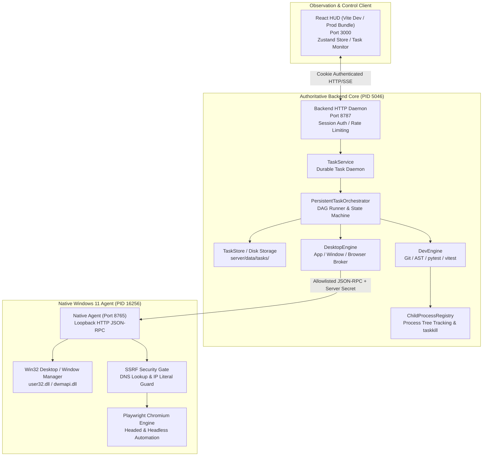
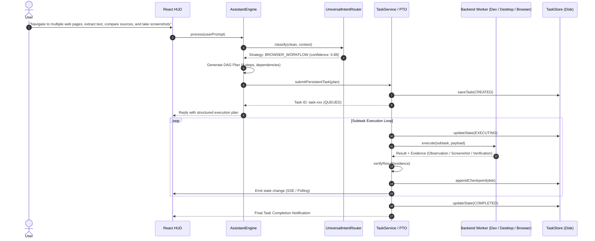
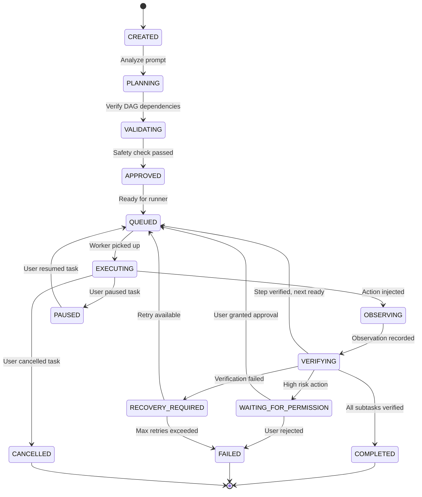

# JARVIS 2.0 — System Architecture Specification
## Universal Personal AI Operating System Architecture

---

## 1. Architectural Philosophy & Core Invariants

JARVIS 2.0 is architected as an autonomous personal AI operating system for Windows 11. It bridges natural-language cognition with verifiable digital execution across development, desktop applications, web browsing, data analysis, and system productivity.

The architecture strictly adheres to three fundamental engineering invariants:

1. **Single Orchestration Authority (`AssistantEngine`):**
   A single, central cognitive engine owns intent routing, goal understanding, structured DAG generation, synthesis, and execution tracking. No secondary or competing planners exist. All autonomous workflows flow from `AssistantEngine` through the `UniversalIntentRouter`.
2. **Durable Backend Execution Ownership (`TaskService`):**
   The persistent Node.js backend daemon (`http://127.0.0.1:8787`) owns long-running task execution, disk checkpoints (`server/data/tasks/`), process lifecycle, and restart recovery. The React HUD (`http://localhost:3000`) is strictly an observation and control client; closing or reloading the frontend never terminates or corrupts running tasks.
3. **Evidence-Based Honest Verification:**
   JARVIS never claims completion without verified evidence (exit code 0, regex-validated test assertions, SHA-256 state hashes, or live desktop/browser observations). Every subtask transitions to `VERIFIED` only when genuine proof is recorded.

---

## 2. Process Topology & IPC Architecture

JARVIS 2.0 operates as a secure tripartite system with sandboxed worker processes:

### Component Roles & Boundaries

| Component | Host / Port | Trust Level | Primary Responsibilities |
| :--- | :--- | :--- | :--- |
| **React HUD** | `http://localhost:3000` | Browser Client | Renders the cybernetic HUD interface, streaming voice transcripts, active Task Monitor, Desktop Observation viewer, and permission approval dialogs. Contains zero credentials. |
| **Backend Core** | `http://127.0.0.1:8787` | Privileged Backend | Central coordination daemon. Manages authenticated sessions, hosts `TaskService`, runs `PersistentTaskOrchestrator`, holds disk checkpoint logs, executes `DevEngine`, and proxies allowlisted RPCs to the native agent. |
| **Native Windows Agent** | `http://127.0.0.1:8765` | OS Host Bridge | High-privilege Win32 agent. Interacts with the Windows Desktop API (`user32.dll`), captures display buffers, manages application processes, injects input, and controls Playwright Chromium browser instances. |
| **Playwright Chromium** | OS Subprocess | Sandboxed Browser | Automates web navigation, DOM element clicks, input typing, page reading, web searching (DuckDuckGo HTML), and visual page screenshots. SSRF-locked against private networks. |

---

## 3. Cognitive Pipeline: Intent Routing to DAG Execution

When the user enters a request, the system processes it through a deterministic multi-stage pipeline:

---

## 4. The Durable Task Lifecycle State Machine

Tasks managed by `PersistentTaskOrchestrator` follow a formal lifecycle:

### State Definitions & Verification Guarantees

- **`CREATED` / `PLANNING`:** The task specification is compiled into a dependency-ordered directed acyclic graph (DAG).
- **`QUEUED`:** All prerequisite dependencies for ready subtasks have passed verification.
- **`EXECUTING`:** The active subtask is dispatched to the dedicated backend worker (`DevEngine`, `DesktopEngine`, or Playwright Chromium).
- **`OBSERVING`:** The system measures the post-action state of the world (file on disk, window title, DOM text, or screenshot).
- **`VERIFYING`:** The observation is compared against expected criteria. If verified, a persistent checkpoint with state hashes is written to disk.
- **`WAITING_FOR_PERMISSION`:** Dangerous or destructive actions (such as file deletion or sensitive process termination) pause execution until the user explicitly approves via the HUD.
- **`RECOVERY_REQUIRED`:** If an action fails its verification check, the system increments retry counters and attempts deterministic recovery before failing.
- **`COMPLETED`:** All subtasks have passed verified execution with concrete evidence recorded in disk checkpoints.

---

## 5. Persistence, Checkpointing, and Restart Recovery

JARVIS 2.0 guarantees durability across backend process restarts, system crashes, or machine reboots.

### Checkpoint Format (`server/data/tasks/<taskId>.json`)
Each checkpoint records:
1. `checkpointId`: Globally unique identifier (`cp-<timestamp>-<hash>`).
2. `taskId`: Association with the parent task.
3. `timestamp`: Epoch millisecond timestamp.
4. `subtaskIndex`: Index of the verified subtask in the DAG.
5. `completedSubtaskIds`: Array of all subtask IDs verified up to this point.
6. `verifiedArtifacts`: Key-value map of execution outputs, file hashes, and evidence strings.
7. `summary`: Human-readable verification summary.
8. `executionStateHash`: SHA-256 digest of the execution environment state.

### Crash Recovery Algorithm
When `TaskService` initializes:
1. Scans `server/data/tasks/` for tasks in non-terminal states (`EXECUTING`, `OBSERVING`, `VERIFYING`, `PLANNING`).
2. Reads the latest valid checkpoint for each interrupted task.
3. Restores verified subtasks to state `VERIFIED` and marks unverified in-flight subtasks as `PENDING`.
4. Transitions the parent task back to `QUEUED`.
5. Background runner loop picks up execution from the last confirmed checkpoint without repeating verified work.

---

## 6. Subsystem Deep Dive

### 6.1 DevEngine (Software Development)
- **Git Safety:** Creates automatic Git checkpoints (`dev.gitCheckpoint`) before patching files; provides instant rollback if tests fail.
- **File Patching:** Employs precise AST and line-targeted patching with SHA-256 pre- and post-verification.
- **Test Runner:** Executes `pytest`, `python -m unittest`, and `vitest` in isolated child processes with process tree tracking via `ChildProcessRegistry`. Strictly rejects shell injection metacharacters.

### 6.2 BrowserEngine (Playwright Chromium)
- **Full Automation:** Implements 11 native RPC methods for page navigation, element interaction, text extraction, search, and screenshots.
- **SSRF Firewall:** Validates every target URL against IPv4/IPv6 private ranges, loopback addresses (`127.0.0.1`, `localhost`), link-local metadata endpoints (`169.254.169.254`), and non-HTTP protocols.
- **Resilience:** Features automatic renderer crash detection and retry logic (`withCrashRetry`).

### 6.3 DesktopEngine (Windows 11 Automation)
- **Window Management:** Win32 `EnumWindows`, `SetForegroundWindow`, `ShowWindow` (minimize, maximize, restore).
- **Process Management:** Application launching, graceful closure, and tree termination.
- **Observation:** High-resolution desktop screenshots, active window inventory, and visual state reporting.
- **Calculations:** Safe sandboxed mathematical evaluation typed directly into Calculator when open.

### 6.4 Document & Data Engine
- **Parsing:** Unified parsing for CSV, TSV, JSON, Markdown, and text files.
- **Statistical Engine:** Computes mean, median, standard deviation, variance, quartiles, IQR, outliers, and linear regression trends ($R^2$, slope, percentage change).
- **Visualization:** Generates declarative Chart.js and Vega-Lite specifications.

### 6.5 ArtifactEngine
- **Outputs:** Standalone interactive HTML dashboards, Markdown technical specs with Mermaid diagrams, and CSV tabular exports.
- **Grounded Citations:** Every claim is explicitly linked to a source file, section, line numbers, and verified text snippet.

