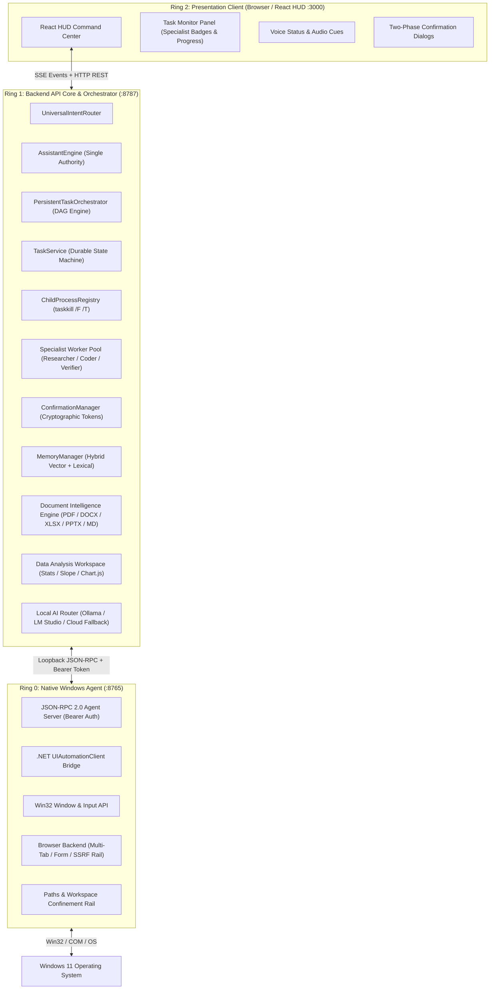
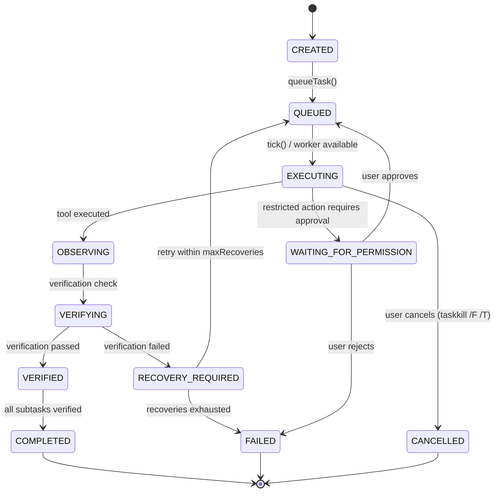

# JARVIS 3.0 — Comprehensive System Architecture Specification
## Universal Personal AI Operating System: Architecture, Invariants, and Data Flow

**Document Version:** 3.0.0  
**Target Platform:** Windows 11 (x64)  
**Workspace:** `D:\JARVIS`  
**Current Branch:** `ui/advanced-hud-polish`  
**Date:** November 2026  

---

## 1. Architectural Invariants & Single Authority Principle

JARVIS 3.0 is built on strict architectural boundaries designed to guarantee deterministic, reliable operation without fragmented planning authorities or client-side leakage:

1. **Single Cognitive Authority:** `AssistantEngine` remains the sole central planner, tool dispatcher, and orchestration authority.
2. **Intent Classification Authority:** `UniversalIntentRouter` classifies natural language inputs into concrete strategies (`DIRECT_ANSWER`, `DEEP_RESEARCH`, `DOCUMENT_INTELLIGENCE`, `DATA_ANALYSIS`, `AUTONOMOUS_DEV`, `BROWSER_WORKFLOW`, `DESKTOP_ACTION`, `MEMORY_OPERATION`, `PRODUCTIVITY`, `MULTIMODAL_REQUEST`).
3. **Durable Backend Execution Authority:** `TaskService` and `PersistentTaskOrchestrator` own the lifecycle of all multi-step, background, and autonomous operations.
4. **Client Independence:** The React HUD Command Center is strictly a presentation and interaction client. It never executes Node.js built-ins (`fs`, `path`, `crypto`) and never makes autonomous execution decisions without the backend.
5. **Controlled OS Bridge:** The Native Windows Agent (`localhost:8765`) is the only component with direct Win32 and .NET UIAutomation privileges, exposed via an authenticated JSON-RPC 2.0 interface.
6. **Bounded Specialist Delegation:** Specialist workers (`researcher`, `coder`, `verifier`) operate under role-based privilege isolation under parent-child task DAG lineage.

---

## 2. Global System Topology

---

## 3. Subsystem Architectural Details

### 3.1 Universal Intent Router & Central Planning (`AssistantEngine`)
- **Intent Router:** Classifies natural language requests deterministically into prioritized execution strategies.
- **Direct Answer Path:** Trivial calculations, system queries, and basic facts execute immediately via local tools with zero background task overhead.
- **Autonomous Task Path:** Multi-step operations (e.g. software development, web research, desktop automation) compile into dependency-ordered Directed Acyclic Graphs (DAGs).

### 3.2 Specialist Worker Delegation & Role Isolation
Specialist sub-agents are spawned as bounded workers under `PersistentTaskOrchestrator`:
- `researcher`: Granted read-only tools (`web.*`, `doc.*`, `data.*`, `browser.navigate`, `browser.extractContent`). Strictly forbidden from modifying files or executing shell commands.
- `coder`: Granted project inspection, file patching (`dev.patchFile`), and test execution tools.
- `verifier`: Granted test runners (`dev.runTests`), audit tools (`dev.auditProject`), and checksum verifiers.

### 3.3 Deep Windows UI Automation (UIA)
- Native bridge in `native/src/agent.ts` connects to Windows `.NET UIAutomationClient`.
- Provides deterministic accessibility tree inspection (`uia.inspect`), pattern invocation (`uia.invoke` for button clicks, menu selections), text value mutation (`uia.setValue`), and state toggling (`uia.toggle`).
- Bounds checking ensures input coordinates and interactions remain within active screen boundaries.

### 3.4 Advanced Browser Automation
- Playwright-powered engine in `native/src/browserInput.ts` with 18 browser tools:
  * Multi-tab management: `listTabs`, `newTab`, `switchTab`, `closeTab`.
  * Semantic form filling: `fillForm` resolves inputs by ID, name, placeholder, aria-label, and `<label>` associations.
  * Structured content extraction: `extractContent` extracts readable text, headings, tabular data, and hyperlinks.
  * Safe download management: `download` validates destination paths against allowed workspace roots.
  * SSRF & loopback protection: `assertPublicHost` rejects `127.0.0.1`, RFC 1918 private IPs, and cloud metadata (`169.254.169.254`).

### 3.5 Real Productivity & Service Integrations
- Provider-based adapter framework:
  * `LocalEmailAdapter`: lists, inspects, and drafts emails; enforces two-phase confirmation before sending.
  * `LocalCalendarAdapter`: manages events, detects scheduling overlap conflicts, exports/imports RFC 5545 `.ics` files, requires approval before deletion.
  * `LocalGitAdapter`: status, diffs, log inspection; gates git commits behind confirmation tokens.
- `ConfirmationManager`: Generates single-use cryptographic confirmation tokens with a 5-minute TTL.

### 3.6 Persistent Personal Memory & Document Intelligence
- Multi-category memory model (`PREFERENCE`, `PROJECT_DECISION`, `WORKFLOW`, `REFERENCE`, `FACT`, `PROFILE`).
- Hybrid ranking combines lexical token matching with dense vector similarity.
- Credential Security Gate: Automatically detects and refuses to store API keys, bearer tokens, passwords, and private keys.
- Document Intelligence: Ingests PDF, DOCX, XLSX, PPTX, CSV, TSV, and Markdown with grounded citation references.

### 3.7 Voice-First Interaction
- Streaming STT: Handles interim partial transcripts with confidence scoring.
- Streaming TTS: Sentence-boundary chunker synthesizes speech in FIFO order without waiting for full response completion.
- Barge-in: Immediate interruption cleans speech audio buffers on user speech detection.
- Procedural Audio Cues: Synthesizes Web Audio tones for wake, recognition, completion, error, and barge-in.

### 3.8 Process Tree Management & Windows Job Objects
- `ChildProcessRegistry` registers all spawned child processes by PID and taskId.
- Cancellation triggers Windows `taskkill /F /T /PID <pid>`, eliminating all child and grandchild processes to prevent orphan resource leaks.
- `ResourceMonitor` tracks host CPU load and memory heap deltas, gating new resource-intensive tasks during system stress.

---

## 4. Subtask Lifecycle State Machine

