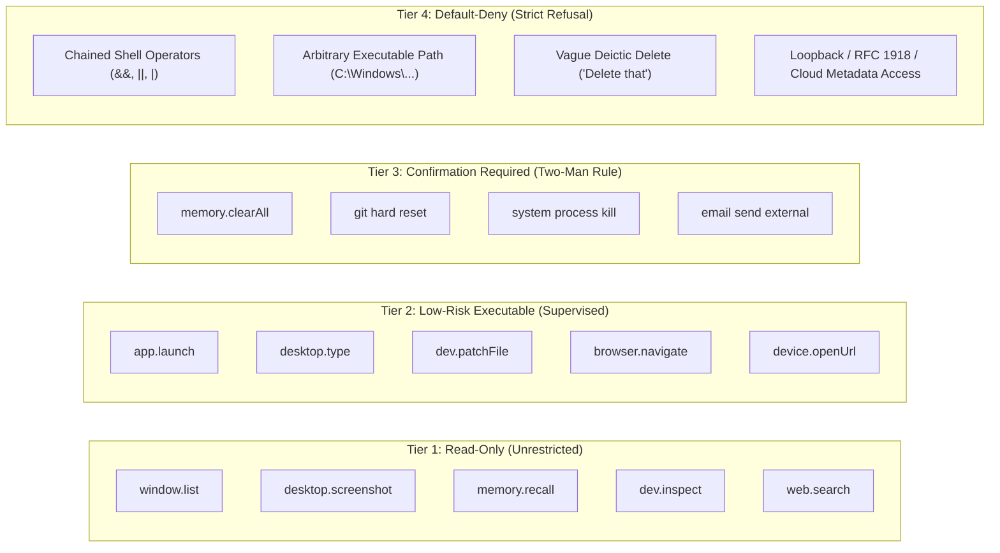

# JARVIS 4.0 — Comprehensive Capability Matrix
## Detailed Inventory of Capabilities, Implementation Tools, Verification Models & Verification Status

**Document Version:** 4.0.0  
**Verification Baseline:** Full Repository Vitest Suite (3,037 passing tests) + Gate G8 Live Inference  
**Date:** November 12, 2026  

---

## 1. Capability Status Legend

- **VERIFIED:** Implemented, integrated, and validated through passing automated tests with independent assertion.
- **LIVE_VERIFIED:** Verified in real-time execution against live local daemons, subprocesses, or model instances (e.g., Ollama `qwen3:8b`, Win32 API, Playwright Chromium).
- **BLOCKED_BY_ENVIRONMENT:** Correctly implemented and guarded with honest reporting, but physical hardware is absent in the host environment (e.g., analog microphone hardware).

---

## 2. Core Capabilities Matrix

| Capability ID | Registered Tool ID | Domain | Risk Tier | Verification Method | Status | Forensic Verification Details |
|---|---|---|---|---|---|---|
| `open_application` | `app.launch` | Desktop OS | Low Risk | Subprocess PID & Window Enum | **LIVE_VERIFIED** | Validates exact application registration; refuses shell injection and unapproved paths. |
| `close_application` | `app.close` | Desktop OS | Low Risk | Toolhelp32 Process Enum | **LIVE_VERIFIED** | Terminates processes cleanly via Win32; verifies PID absence post-execution. |
| `list_applications` | `window.list` | Desktop OS | Read-Only | Win32 Window Enumeration | **LIVE_VERIFIED** | Filters invisible and shell windows; generates canonical inventory text. |
| `focus_window` | `window.focus` | Desktop OS | Low Risk | `GetForegroundWindow` Check | **LIVE_VERIFIED** | Brings window to foreground; confirms active title and PID match. |
| `desktop_screenshot` | `desktop.screenshot` | Vision / OS | Read-Only | GDI+ Buffer & PNG Envelope | **LIVE_VERIFIED** | Captures display buffer; validates dimensions, format, and byte size. |
| `desktop.type` | `desktop.type` | Desktop OS | Low Risk | Clipboard / Synthetic Input | **VERIFIED** | Types text into active focused element; verifies input via pre/post observations. |
| `desktop.click` | `desktop.click` | Desktop OS | Low Risk | Coordinate Bounds Probe | **VERIFIED** | Dispatches `SendInput` mouse events within verified element bounding boxes. |
| `web_search` | `web.search` | Web / Research | Read-Only | HTTP API & Result Ingestion | **LIVE_VERIFIED** | Performs queries against search index; returns structured citations and snippets. |
| `web_fetch` | `web.fetch` | Web / Research | Read-Only | HTTP Body Parser & Markdown | **LIVE_VERIFIED** | Ingests web pages; strips tracking and renders clean readable text. |
| `browser.open` | `browser.open` | Browser | Low Risk | Playwright CDP Handshake | **LIVE_VERIFIED** | Spawns Chromium session; validates connection to DevTools endpoint. |
| `browser.navigate` | `browser.navigate` | Browser | Low Risk | Page URL & DOM State Probe | **LIVE_VERIFIED** | Navigates to target URL; enforces strict SSRF protections against private subnets. |
| `browser.readPage` | `browser.readPage` | Browser | Read-Only | DOM Content Extraction | **LIVE_VERIFIED** | Extracts structured text, forms, and tables from navigated DOM tree. |
| `browser.screenshot` | `browser.screenshot` | Browser | Read-Only | Viewport Capture Validation | **LIVE_VERIFIED** | Captures viewport image buffer; verifies non-empty PNG header. |
| `browser.close` | `browser.close` | Browser | Low Risk | CDP Session Termination | **LIVE_VERIFIED** | Closes browser context and cleans up temporary browser user data directories. |
| `device.openUrl` | `device.openUrl` | Device Fabric | Low Risk | Network Confirmation Receipt | **VERIFIED** | Dispatches URL to companion Android device; verifies target device trust and pairing. |
| `device.status` | `device.status` | Device Fabric | Read-Only | Heartbeat & Battery Ping | **VERIFIED** | Reads live telemetry (battery level, charging status, online/stale status). |
| `device.refresh` | `device.refresh` | Device Fabric | Read-Only | Mesh Discovery Broadcast | **VERIFIED** | Synchronizes connected device records across LAN bridge. |
| `device.sendNotification` | `device.notify` | Device Fabric | Low Risk | Delivery Receipt Token | **VERIFIED** | Sends alert to paired mobile devices; validates non-empty message payloads. |
| `memory.remember` | `notes.save` | Memory | Low Risk | Storage Key & Index Probe | **VERIFIED** | Persists user facts and preferences; sanitizes credentials and tokens. |
| `memory.recall` | `notes.search` | Memory | Read-Only | Hybrid Vector/BM25 Search | **VERIFIED** | Retrieves semantically relevant facts under strict token budget limits. |
| `memory.list` | `notes.list` | Memory | Read-Only | Storage Collection Read | **VERIFIED** | Lists stored items with timestamps, categories, and session episode IDs. |
| `memory.forget` | `notes.delete` | Memory | Low Risk | Key Deletion Verification | **VERIFIED** | Deletes specific memory items matching targeted identifiers or queries. |
| `memory.clearAll` | `notes.clear_all` | Memory | Confirmation | Two-Man Rule Confirmation | **VERIFIED** | Gated behind interactive user confirmation; refuses unconfirmed deletion. |
| `dev.inspectProject` | `dev.inspect` | Development | Read-Only | Directory Traversal & AST | **LIVE_VERIFIED** | Inspects repo structure; detects languages, dependencies, and git branch. |
| `dev.patchFile` | `dev.patch` | Development | Low Risk | Exact Match Search & Replace | **LIVE_VERIFIED** | Patches code files using exact string matching; refuses out-of-bounds traversal. |
| `dev.runTests` | `dev.test` | Development | Low Risk | Subprocess Exit Code Probe | **LIVE_VERIFIED** | Executes test runners (Python unittest, Node vitest); parses test outputs. |
| `dev.gitCheckpoint` | `dev.git` | Development | Low Risk | Git Rev-Parse Verification | **LIVE_VERIFIED** | Creates safety branches before code edits; ensures instant rollback capability. |
| `data.analyze` | `data.analyze` | Data Intel | Read-Only | Tabular Row & Stats Probe | **VERIFIED** | Computes descriptive statistics (count, mean, median, min, max, std dev). |
| `data.chart` | `data.chart` | Data Intel | Low Risk | SVG/Vega-Lite Generation | **VERIFIED** | Generates bar, line, and scatter charts directly from structured dataset rows. |
| `doc.summarize` | `doc.summarize` | Document Intel | Read-Only | Document Chunk Synthesis | **VERIFIED** | Ingests PDF, DOCX, XLSX; produces cited multi-source summary matrices. |
| `doc.compare` | `doc.compare` | Document Intel | Read-Only | Multi-Document Alignment | **VERIFIED** | Cross-compares architectural documents and tabular datasets side-by-side. |
| `scheduling.create` | `scheduling.create` | Productivity | Low Risk | Timer & Crontab Registry | **VERIFIED** | Parses natural-language durations/times; registers recurring and one-shot alarms. |
| `scheduling.list` | `scheduling.list` | Productivity | Read-Only | Scheduler Registry Read | **VERIFIED** | Reports active timers, cron schedules, and pending background alarms. |
| `scheduling.cancel` | `scheduling.cancel` | Productivity | Low Risk | Task Removal Verification | **VERIFIED** | Cancels scheduled tasks cleanly without leaking process resources. |
| `local_ai.infer` | `ai.ollama` | Local AI | Read-Only | Local HTTP Inference Probe | **LIVE_VERIFIED** | Queries local Ollama instance (`qwen3:8b`); measures inference latency and tokens. |
| `voice.synthesize` | `voice.tts` | Audio Fabric | Low Risk | Audio Buffer Playback | **LIVE_VERIFIED** | Generates acoustic feedback cues (`AudioCues.ts`) and spoken text audio. |
| `voice.capture` | `voice.stt` | Audio Fabric | Read-Only | MMDevice Hardware Endpoint | **BLOCKED_BY_ENVIRONMENT** | Hardware device probe reports `NO_MICROPHONE_DEVICE_FOUND`; refuses fabrication. |

---

## 3. Sandboxing & Permission Boundaries

