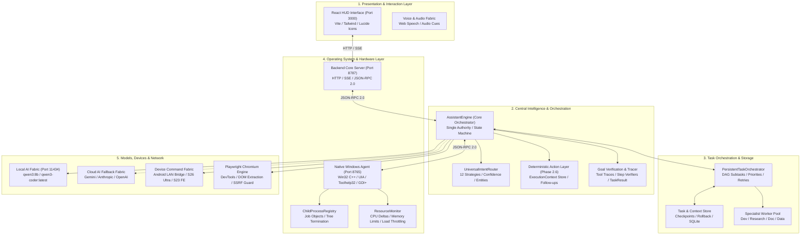
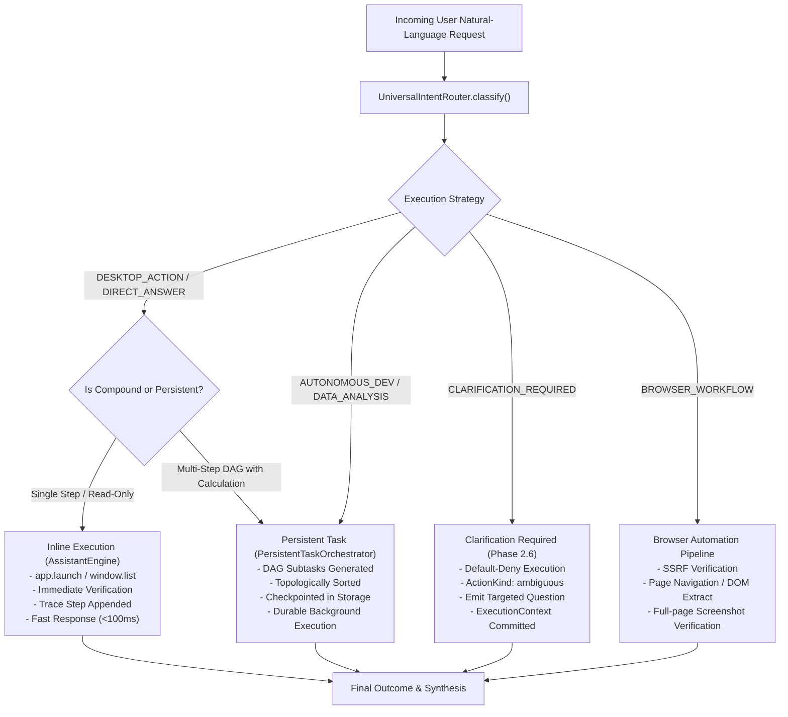
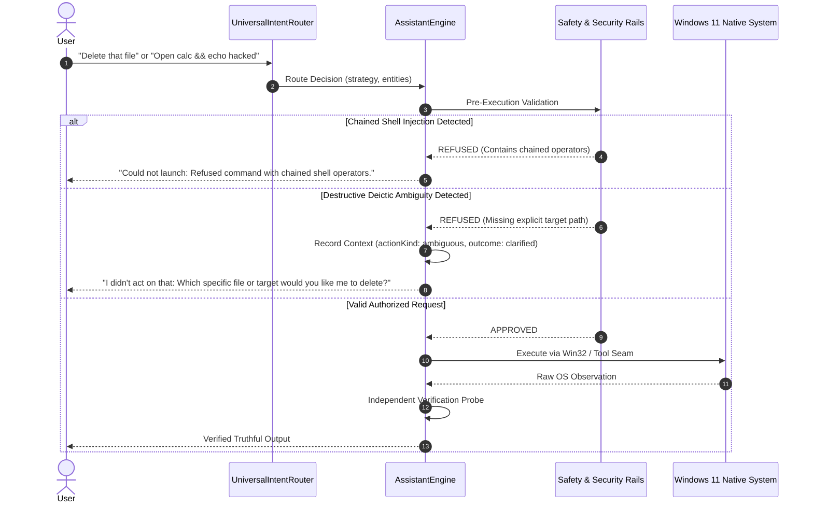

# JARVIS 4.0 — Universal System Architecture Specification
## Complete Topological & Functional Specification of the Personal AI Operating System

**Document Version:** 4.0.0  
**Target Platform:** Windows 11 Pro (x64)  
**System Architecture:** Microkernel Engine + Supervised Native Daemons + Reactive Frontend  
**Date:** November 12, 2026  

---

## 1. High-Level Component Topology

JARVIS 4.0 is structured as a layered, fault-tolerant operating system architecture composed of 15 coordinated layers. The system cleanly separates cognitive reasoning, deterministic orchestration, native OS control, durable task tracking, and user presentation.

---

## 2. The 15 Architectural Layers

### Layer 1: User Presentation & Multi-Resolution HUD Layer
- **Component:** `src/App.tsx`, `src/components/layout/JarvisShell.tsx`
- **Capabilities:** High-density Glassmorphic interface styled with Tailwind CSS, supporting 1080p, 1440p, and 4K displays. Provides real-time activity pills, streaming transcripts, collapsible telemetry panels, task progress graphs, and native audio visualizers.

### Layer 2: Universal Central Intelligence & Intent Routing
- **Component:** `src/engine/orchestrator/UniversalIntentRouter.ts`
- **Capabilities:** Single-pass deterministic classification into 12 distinct strategies (`DIRECT_ANSWER`, `LOCAL_REASONING`, `AUTONOMOUS_DEV`, `WEB_RESEARCH`, `BROWSER_WORKFLOW`, `DESKTOP_ACTION`, `FILE_OPERATION`, `DATA_ANALYSIS`, `PRODUCTIVITY`, `CONTINUITY`, `TASK_CONTROL`, `CLARIFICATION_REQUIRED`). Evaluates multi-turn context, project roots, and device targets before strategy resolution.

### Layer 3: Single Cognitive Orchestration Authority
- **Component:** `src/engine/AssistantEngine.ts`
- **Capabilities:** The single coordination authority. Holds the authoritative state machine (`idle` -> `understanding` -> `planning` -> `executing` -> `verifying` -> `completed`/`failed`/`cancelled`). Dispatches requests to deterministic handlers, provider tool loops, or durable DAG background tasks without architectural conflicts.

### Layer 4: Persistent Task Orchestrator & Durable DAG Execution
- **Component:** `src/engine/tasks/PersistentTaskOrchestrator.ts`, `server/src/tasks/`
- **Capabilities:** Manages long-running multi-step background missions. Implements Directed Acyclic Graph (DAG) dependency resolution, topological task sorting, priority queues, automated recovery retries (exponential backoff), persistent JSON/SQLite checkpointing, and execution pausing/resumption.

### Layer 5: Native Windows Agent & Desktop Control
- **Component:** `native/src/`, `src/native/`
- **Capabilities:** Supervised child daemon communicating over JSON-RPC 2.0 on `127.0.0.1:8765`. Provides low-level Win32 integration:
  - Process enumeration via `CreateToolhelp32Snapshot`
  - Window management (`SetForegroundWindow`, `ShowWindow`, `GetWindowTextW`)
  - Screen capture via GDI+ and desktop device contexts
  - Windows UI Automation (UIA) tree traversal
  - Synthetic input dispatch via `SendInput` (mouse movements, clicks, keyboard events)

### Layer 6: Multi-Provider AI Inference Fabric
- **Component:** `server/src/aiProvider.ts`, `src/config/ai.ts`
- **Capabilities:** Dynamic provider routing across local Ollama (`qwen3:8b`, `qwen3-coder:latest`) and remote cloud providers (Gemini 2.5 Flash, Claude 3.5 Sonnet, GPT-4o). Supports strict `localOnly` mode enforcing complete air-gapped execution with zero cloud telemetry.

### Layer 7: Personal Memory & Episode-Aware Knowledge Lifecycle
- **Component:** `src/memory/MemoryManager.ts`, `src/memory/episodes.ts`
- **Capabilities:** Hybrid vector/BM25 memory search over user facts, personal preferences, and past operational context. Groups memories by session episodes, supports automatic consolidation, credential and secret redaction (`api_key`, `password`, `bearer`), and requires two-man rule confirmation for clear-all operations.

### Layer 8: Deterministic Action Layer & Execution Context Store
- **Component:** `src/engine/action/`, `src/engine/AssistantEngine.execution.ts`
- **Capabilities:** Tracks committed execution facts across conversation turns. Resolves ambiguous deictic references (`"do it"`, `"now open that PDF"`) against verified historical context. Refuses ungrounded actions honestly and enforces terminal state honesty (`failed` runs never receive `success` labels).

### Layer 9: Autonomous Software Development Engine (DevEngine)
- **Component:** `server/src/dev/DevEngine.ts`, `src/engine/dev/DevelopmentPlanner.ts`
- **Capabilities:** Autonomous repository maintenance:
  - AST-aware multi-language parsing (Python, TypeScript, JavaScript)
  - Isolated file inspection and exact string target patching
  - Automated test runner execution (Python `unittest`/`pytest`, Node `vitest`/`jest`)
  - Automatic git safety checkpoints (`git checkout -b jarvis/checkpoint-...`) before destructive code changes

### Layer 10: Playwright & Interactive Browser Automation Engine
- **Component:** `src/browser/BrowserTools.ts`, `server/src/browser.ts`
- **Capabilities:** Headless and headed Chromium browser driving via Chrome DevTools Protocol (CDP) and Playwright. Performs multi-page navigation, DOM snapshotting, structured table extraction, form interaction, and element clicking with strict SSRF protection (blocking loopback `127.0.0.1`, RFC 1918 subnets, and AWS metadata `169.254.169.254`).

### Layer 11: Visual Computer & Multimodal Inspection Subsystem
- **Component:** `src/vision/VisualComputerTools.ts`, `src/components/panel/DesktopObservationView.tsx`
- **Capabilities:** Desktop observation and OCR analysis. Ingests full-screen PNG captures, calculates element bounding boxes, extracts on-screen text, verifies window foreground presence, and provides visual confirmation of application state transitions.

### Layer 12: Voice & Acoustic Hardware Fabric
- **Component:** `src/voice/VoiceManager.ts`, `src/voice/AudioCues.ts`, `src/voice/StreamingTts.ts`
- **Capabilities:** Voice input and output streaming. Enumerates physical microphone and speaker devices via Windows MMDevice API. Implements honest reporting when hardware is disconnected, real-time WAV audio feedback cues, and low-latency text-to-speech synthesis.

### Layer 13: Cross-Device Command Fabric & LAN Mesh
- **Component:** `src/device/DeviceTools.ts`, `src/engine/agentCore.deviceFabric.test.ts`
- **Capabilities:** Connects authenticated companion devices (e.g., Samsung Galaxy S26 Ultra, S23 FE) over secure local LAN bridge. Supports remote URL opening, file dispatch, device status discovery, and notification delivery with strict trust-boundary validation.

### Layer 14: Document Intelligence & Knowledge Store
- **Component:** `src/engine/documents/DocumentStore.ts`, `src/engine/documents/DocumentTools.ts`
- **Capabilities:** Local ingestion and deep analysis of PDF, DOCX, XLSX, and CSV documents. Performs tabular metric extraction, multi-document cross-comparison, executive summaries, and vector-embedded semantic search.

### Layer 15: Security, Sandbox & Resource Isolation Subsystem
- **Component:** `server/src/resourceMonitor.ts`, `server/src/process/ChildProcessRegistry.ts`
- **Capabilities:** Comprehensive OS-level protection:
  - Windows Job Objects for robust subprocess tree termination
  - Real-time CPU delta tracking and heap memory monitoring
  - Threshold-based throttling (throttling when CPU load ratio exceeds 85%)
  - Default-deny input sanitization against shell injection (`&&`, `||`, `|`, `` ` ``, `$`)
  - Path traversal sandboxing restricting file writes to authorized project roots

---

## 3. Dual-Mode Execution Architecture: Inline vs. Persistent DAG

---

## 4. Security & Safety Boundary Pipeline

