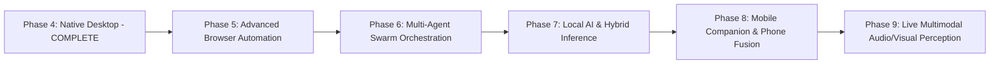

# JARVIS Universal Personal AI Operating System — Remaining Engineering Roadmap
**Strategic Evolution & Next Phase Implementation Plan**  
**Document Version:** 1.0.0  
**Target Architecture:** JARVIS 1.0 Universal Personal AI Operating System

---

## 1. Executive Roadmap Overview

Following the successful completion of the Overnight Master Mission, JARVIS has established a rock-solid foundation:
- Universal strategy routing (`UniversalIntentRouter`).
- Autonomous software engineering (`DevEngine`).
- Native Windows 11 desktop automation with Win32 observation and interaction (`DesktopEngine`).
- Durable backend task persistence and restart recovery (`TaskService`, `PersistentTaskOrchestrator`).
- Windows process tree lifecycle management (`ChildProcessRegistry`).
- Windows-specific resource monitoring (`ResourceMonitor`).
- Grounded document intelligence and deterministic data analysis (`DocumentStore`, `DataAnalysisTools`).

The remaining engineering roadmap moves JARVIS from a single-machine desktop agent to a truly ubiquitous, multimodal personal AI operating system.

---

## 2. Prioritized Implementation Phases

### Phase 5: Advanced Browser Automation & Deep Web Interaction
**Target Timeline:** Next Sprint  
**Priority:** High  
**Objective:** Evolve beyond basic HTTP scraping to resilient, authenticated, client-rendered web automation using native Playwright.

#### Key Deliverables:
1. **Persistent Browser Contexts:**
   - Store browser cookies, session tokens, and local storage in `server/data/browser_sessions/` so JARVIS stays logged in across restarts.
2. **Deterministic DOM Selection & Visual Grounding:**
   - Combine CSS/XPath selectors with visual accessibility tree inspection (ARIA roles, labels, text contents).
   - "Eyes before hands" web verification: take page screenshot before and after clicking/submitting to confirm page transitions.
3. **Multi-Tab Orchestration:**
   - Allow background tasks to manage parallel browser tabs without stealing foreground window focus from the user.
4. **Verification Milestone:**
   - Automate a complete authenticated multi-step workflow: navigate to an issue tracker, create an issue, upload an attachment, verify creation evidence.

---

### Phase 6: Multi-Agent Swarms & Autonomous Task Sharding
**Target Timeline:** Medium-term  
**Priority:** High  
**Objective:** Enable `AssistantEngine` to shard large-scale objectives into specialized, parallel worker subagents collaborating over a shared task board.

#### Key Deliverables:
1. **Worker Pool Management:**
   - Implement `SwarmCoordinator` within `server/src/tasks/` to spawn lightweight worker instances pinned to specific domains (e.g., Code Worker, Research Worker, Test Verifier).
2. **Worktree & Workspace Isolation:**
   - Provide each code worker with an isolated Git worktree (`git worktree add`) to prevent concurrent file mutation collisions.
3. **Inter-Agent Verification Rail:**
   - Dedicated `VerifierAgent` that independently audits code changes made by worker agents before merging into the main branch.
4. **Verification Milestone:**
   - Submit: "Research modern vector databases, create a benchmark test suite comparing Qdrant vs Chroma, execute benchmarks, and generate comparative report." Coordinated across 3 parallel agents.

---

### Phase 7: Local Offline AI & Hybrid Inference Engine
**Target Timeline:** Medium-term  
**Priority:** Medium  
**Objective:** Ensure JARVIS functions with zero internet connectivity using embedded local models (e.g., Llama 3.2, Phi-3, Mistral) via ONNX Runtime / Ollama / llama.cpp.

#### Key Deliverables:
1. **Hybrid Model Router:**
   - Intelligently route tasks: local lightweight model for intent routing, status extraction, and basic code edits; cloud frontier model for complex architectural planning.
2. **Automatic Local Fallback:**
   - Seamlessly degrade to local inference when internet or API provider reachability drops, without throwing fatal runtime errors.
3. **Local Vector Embeddings:**
   - Embedded ONNX miniLM model for local document vector retrieval without external API calls.
4. **Verification Milestone:**
   - Disconnect network adapter. Execute full software dev and document analysis task with 100% offline completion.

---

### Phase 8: Mobile Companion & Ambient Telephony Fusion
**Target Timeline:** Extended  
**Priority:** Medium  
**Objective:** Fully activate the paired Android companion server (`http://0.0.0.0:8788`) for unified call, SMS, and notification bridging.

#### Key Deliverables:
1. **Secure LAN Pairing Flow:**
   - QR-code-based cryptographic handshake between React HUD and Android companion app.
2. **Telephony Bridge:**
   - Send and receive SMS through Android bridge with user permission confirmation.
   - Outgoing call dispatch with caller ID management.
3. **Proximity & Presence Awareness:**
   - Detect user proximity via Bluetooth LE / Wi-Fi LAN signals to automatically lock/unlock desktop HUD state.
4. **Verification Milestone:**
   - User voice prompt: "Text John that I'll be 10 minutes late." JARVIS verifies phone connection, confirms text with user, sends SMS, and confirms delivery receipt.

---

### Phase 9: Live Multimodal Audio/Visual Perception
**Target Timeline:** Long-term  
**Priority:** Low  
**Objective:** Continuous, low-latency ambient observation of user workspace via live webcam and microphone feeds.

#### Key Deliverables:
1. **On-Device Voice Activity Detection (VAD):**
   - Silero VAD running in WebAssembly to detect speech start/stop with sub-50ms latency.
2. **Streaming Vision Understanding:**
   - Periodically analyze webcam stream (when explicitly enabled) for user presence, physical gestures, and workspace context.
3. **Privacy Kill-Switch:**
   - Physical hardware indicators and global software kill-switch to guarantee complete microphone and camera deactivation.

---

## 3. Architectural Risks & Mitigation Strategies

| Risk Factor | Impact | Mitigation Strategy |
| :--- | :--- | :--- |
| **Windows UI Automation Drifting** | High | Always verify application launch via process ID (`GetWindowThreadProcessId`) before relying on window title matching. |
| **Orphaned Background Subprocesses** | Critical | Enforce `ChildProcessRegistry.killProcessTree` on every task cancellation and exit. |
| **Host Resource Exhaustion** | High | Integrate `ResourceMonitor` into task dispatch loop; throttle when free RAM < 250 MB or CPU load > 85%. |
| **Model Hallucination on File Paths** | High | Enforce canonical path checking and `statSync` pre-flight checks before attempting file mutations. |
| **Frontend Credential Leakage** | Critical | Continuous enforcement of `scripts/check-frontend-secrets.mjs` in CI/CD and pre-build hooks. |

