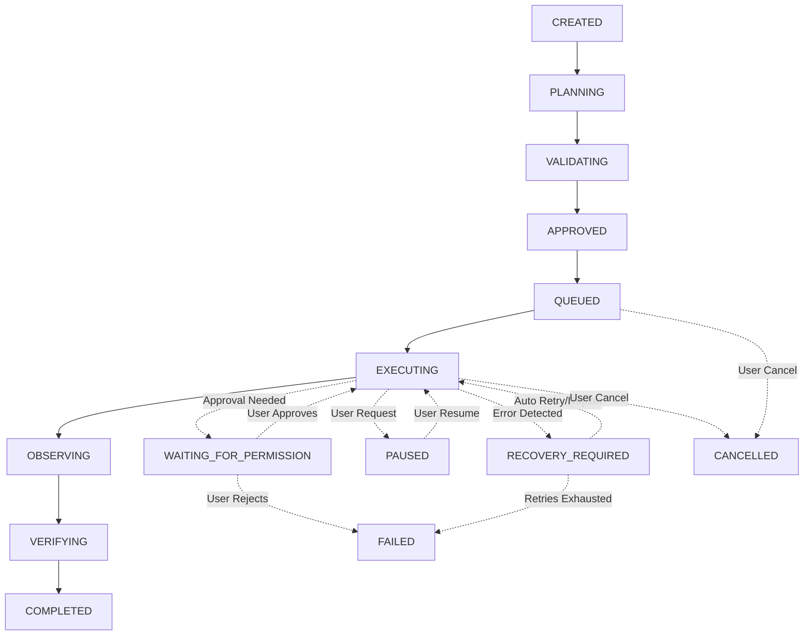

# JARVIS Autonomous Persistent Task Orchestrator

## 1. Executive Summary & Vision

JARVIS has evolved from an interactive personal assistant into a persistent, autonomous, background-running personal AI agent. 

The primary operational paradigm allows the user to issue a single natural-language directive:
> *"JARVIS, fix my ProjectHub project. Audit the repository, identify missing functionality, implement necessary fixes, test everything and ensure the application works correctly."*

JARVIS autonomously:
1. Understands the objective and parses project targets.
2. Retrieves and updates project-specific context (separated from long-term memory).
3. Develops a structured execution plan with prioritized subtask DAG dependencies.
4. Validates the plan against registered capabilities and the default-deny permission boundary.
5. Executes subtasks sequentially or in safe parallel batches via `AssistantEngine`.
6. Observes tool results and extracts concrete verification evidence.
7. Detects failures, classifies errors, and applies bounded recovery strategies.
8. Persists incremental state checkpoints to durable storage.
9. Recovers interrupted tasks across application and PC restarts without re-executing verified actions.
10. Provides live visual progress in the JARVIS HUD and dispatches native Windows notifications upon completion or required approval.

---

## 2. Core Architectural Principles

### Single Orchestration Authority
- **`AssistantEngine` remains the single orchestration authority.** No secondary or competing orchestrator is introduced.
- `PersistentTaskOrchestrator` serves as the durable lifecycle and state machine manager. For actual subtask execution, it delegates directly back to `AssistantEngine.executePersistentSubtask`.
- Every subtask execution passes through the standard JARVIS security pipeline:
  ```
  Tool Resolution → Input Validation → Capability Check → Permission Gate (Default-Deny) → Tool Execution → Verification Evidence Rail
  ```

### Deterministic Development Planning
- Natural-language development objectives are planned by `src/engine/dev/DevelopmentPlanner.ts`, not by an LLM.
- The planner emits only canonical `dev.*` steps with explicit dependencies. The circle-area objective produces an 8-step DAG: inspect → Git status → safety checkpoint → implementation → tests file → real test run → on-disk verification → execution report.
- Paths are normalized before planning: sentence punctuation (for example `D:\JARVIS-Test.`) is stripped, so Windows never addresses an unreachable trailing-dot directory.
- A development request can never select `application_status`, and the word `"results"` is never treated as an application id.
- `npm run build:engine` (part of `npm run build`) regenerates `server/dist/engine.mjs`; the backend never runs a stale engine bundle.

### Memory and Continuity Separation
To avoid pollution between personal preferences and project mechanics:
- **Personal Memory (`MemoryManager`):** Holds user preferences, facts, and conversation episodes.
- **Project Context (`ProjectContextStore`):** Stores project roots, detected tech stack, test commands, git branch state, and active objectives.
- **Task Store (`TaskStore`):** Manages durable task lifecycle, subtasks, DAG dependencies, approval requests, checkpoints, and execution history.
- **Execution Logs:** Detailed stdout/stderr and audit trails captured during tool runs.

---

## 3. Persistent Task Lifecycle

Tasks strictly follow a deterministic lifecycle. A task is **never** marked completed simply because an LLM or agent outputted a conversational success message; verified execution evidence is mandatory.



### Task & Subtask States
| State | Description |
|---|---|
| `CREATED` | Task initialized with user objective and metadata. |
| `PLANNING` | Execution plan and subtasks are being formulated. |
| `VALIDATING` | Tool capabilities, argument schemas, and permissions are verified. |
| `APPROVED` | Plan meets security policies and is ready to enter queue. |
| `QUEUED` | Task is in the execution queue awaiting available system resources. |
| `EXECUTING` | An active subtask is running its registered tool. |
| `OBSERVING` | Tool output, exit codes, and side effects are being captured. |
| `VERIFYING` | Execution results are checked against formal verification criteria. |
| `COMPLETED` | All subtasks verified with concrete evidence. |
| `PAUSED` | Task execution paused by user; can be resumed. |
| `WAITING_FOR_PERMISSION` | Execution halted pending explicit user approval for a high-risk operation. |
| `FAILED` | Terminal failure or unrecoverable error encountered. |
| `CANCELLED` | Task terminated by user. |
| `RECOVERY_REQUIRED` | Transient failure or restart detected; recovery engine is restoring from checkpoint. |

---

## 4. Subtask DAG & Relative Dependency Resolution

Subtasks within a task can depend on one another. The engine supports both absolute subtask IDs and relative step references (`step-1`, `step-2`, etc.):
- Subtask 1: `Inspect repository stack` (produces detected stack)
- Subtask 2: `Run baseline test suite` (depends on `step-1`)
- Subtask 3: `Apply targeted patch` (depends on `step-2`)
- Subtask 4: `Run verification test suite` (depends on `step-3`)

The orchestrator enforces that subtasks only enter `READY` when all prerequisites have reached `VERIFIED`.

---

## 5. Background Execution & Windows Native Integration

JARVIS operates reliably in the background without requiring the UI window to remain open.

### Component Architecture
```text
┌─────────────────────────────────────────────────────────────┐
│                      Windows Host                           │
│                                                             │
│  ┌───────────────────────┐       ┌───────────────────────┐  │
│  │   Vite Frontend HUD   │◄─────►│   Loopback Backend    │  │
│  │   (Port 3000)         │  SSE  │   (Port 8787)         │  │
│  │   - TaskMonitorPanel  │ HTTP  │   - TaskService       │  │
│  │   - Controls & Badges │       │   - ResourceMonitor   │  │
│  └───────────────────────┘       │   - Windows Notifier  │  │
│                                  │   - Durable Storage   │  │
│                                  └───────────┬───────────┘  │
│                                              │              │
│                                  ┌───────────▼───────────┐  │
│                                  │   PowerShell Native   │  │
│                                  │   Toast Notification  │  │
│                                  └───────────────────────┘  │
└─────────────────────────────────────────────────────────────┘
```

### Execution Hosts
- **HUD-initiated development tasks** are planned and sequenced by the HUD `AssistantEngine`/`PersistentTaskOrchestrator`. Every `dev.*` step is dispatched over the authenticated `POST /api/dev/execute` endpoint and executes in the backend `DevEngine`; the HUD never imports Node filesystem/Git/child-process modules.
- **Backend `/api/tasks` tasks** are durable: `TaskService` persists them under the server data directory, executes them headlessly through the bundled `server/dist/engine.mjs` (or the direct `dev.*` executor), and survives HUD disconnects and restarts.
- Backend submission is serialized: concurrent identical requests with the same idempotency key resolve to one task instead of starting duplicate runs. Sensitive backend `dev.*` capabilities are default-deny until an explicit approval is recorded and persisted.
- The Task Monitor merges both sources by task id. Backend polling can no longer erase a HUD-owned task from the panel.

### Windows Restart & Recovery Engine
1. **Periodic & Step-Level Checkpoints:** Every subtask completion generates a cryptographically hashed execution checkpoint saved to `.jarvis/tasks/` (or `%USERPROFILE%/.jarvis/tasks/`).
2. **Crash & Restart Recovery:** Upon backend initialization (`TaskService.start()`), `recoverInterruptedTasks()` scans for tasks that were mid-execution (`EXECUTING` or `OBSERVING`). They are transitioned to `RECOVERY_REQUIRED` and resumed safely from their last verified checkpoint without re-running completed subtasks.
3. **Resource Awareness:** `ResourceMonitor` checks CPU load ratio and free RAM before dequeueing heavy execution tasks, ensuring JARVIS does not starve user applications on an awake/idle machine.
4. **Native Windows Notifications:** When tasks finish, fail, or need approval, `notifyWindowsTaskEvent()` dispatches Windows PowerShell toast notifications.

---

## 6. Autonomous Development Agent (`dev.*` Tools)

A specialized tool suite enables autonomous engineering on software repositories:

| Tool | Capability | Safety Guardrail |
|---|---|---|
| `dev.inspectProject` | Analyzes directory layout, package manifests, configs, and frameworks. | Read-only. Safe path confinement. |
| `dev.gitStatus` | Inspects current branch, staged/unstaged changes, and untracked files. | Read-only. Prevents working on dirty state unexpectedly. |
| `dev.gitCheckpoint` | Creates safety branches (`jarvis-checkpoint-...`) prior to modifications. | Never commits or pushes to remote; preserves user branches. |
| `dev.patchFile` | Performs targeted string/block replacements. | **Strictly refuses whole-file blind overwrites.** Auto-creates `.bak` backup. |
| `dev.runTests` | Executes test runner commands (`npm test`, `pytest`, etc.). | Honest evaluation: parses exit codes, stdout/stderr, passed/failed test counts. |
| `dev.auditProject` | Runs linters and typecheckers (`npm run lint`, `tsc --noEmit`). | Captures warnings and syntax errors. |
| `dev.generateReport` | Compiles comprehensive markdown audit and completion reports. | Includes diffs, verification hashes, and test results. |

### Honest Verification Evidence
- `dev.inspectProject` verifies the resolved directory and (when requested) required files with byte and SHA-256 evidence.
- `dev.patchFile` refuses blind overwrites, re-reads the written file from disk, and returns its SHA-256.
- `dev.runTests` parses the real process exit code and pass/fail counts; a missing runner is reported as such, never fabricated.
- `dev.generateReport` accepts only evidence produced by earlier verified subtasks (`buildDevPayload`), writes the report, and re-reads it before reporting success.
- The backend `TaskService` re-verifies every `dev.*` result (`verifyDevResult`) instead of trusting `ok: true`.

### Deterministic Circle-Area Plan
For `Inspect D:\JARVIS-Test. Create a Python circle-area program and tests, execute and verify them, and generate a report`:

1. `dev.inspectProject` (create the explicit leaf directory only when the user named it)
2. `dev.gitStatus`
3. `dev.gitCheckpoint` (local checkpoint branch; never a push)
4. `dev.patchFile` → `circle.py`
5. `dev.patchFile` → `test_circle.py`
6. `dev.runTests` → `python -m unittest test_circle.py`
7. `dev.inspectProject` → require `circle.py` and `test_circle.py` on disk
8. `dev.generateReport` → `JARVIS_EXECUTION_REPORT.md`

---

## 7. Intelligent Recovery & Error Classification

When a subtask fails, `classifyTaskError()` analyzes the error signature:

```text
Error Message / Context
       │
       ├─► "ECONNREFUSED", "timeout", "ETIMEDOUT" ───────► RETRYABLE_TRANSIENT (Exponential Backoff)
       ├─► "429", "rate limit", "quota" ─────────────────► RATE_LIMITED (Delay & Retry)
       ├─► "EACCES", "permission denied", "unauthorized" ─► PERMISSION_REQUIRED (Halt & Request Approval)
       ├─► "ENOENT", "command not found", "cannot find" ──► DEPENDENCY_MISSING (Report Missing Tool)
       ├─► "invalid argument", "schema mismatch" ─────────► INVALID_INPUT (Replan Subtask)
       └─► General syntax / runtime exceptions ───────────► TERMINAL_FAILURE (Stop & Report)
```

Recovery attempts are bounded by `maxRetries` per subtask to prevent infinite loops.

---

## 8. Security & Default-Deny Model

Autonomy does not compromise host security. The orchestrator enforces strict boundaries:
- **Default-Deny Policy:** File deletions, shell command execution outside registered tools, remote git pushes, package installations, and access to secrets require explicit approval.
- **Pending Approvals in UI:** When an action requires approval, the task state switches to `WAITING_FOR_PERMISSION` and generates a structured `approvalRequest` containing:
  - Action name and tool.
  - Resource target (file path or command).
  - Risk assessment (impact level).
  - One-click `Approve` or `Reject` buttons in `TaskMonitorPanel`.

---

## 9. Live Task Monitoring UI (`TaskMonitorPanel`)

Integrated directly into the JARVIS HUD workspace as a dockable panel:
- **Header Badges:** Displays active filter tabs (`All`, `Active`, `Completed`, `Failed`) with live counters.
- **Honest Progress Indicator:** Progress bar is calculated strictly as `(verifiedSubtasks / totalSubtasks) * 100%`, never fabricated.
- **Subtask Checklist:**
  - Status indicators (`PENDING`, `EXECUTING`, `VERIFIED`, `FAILED`).
  - Priority pills (`HIGH`, `CRITICAL`, `NORMAL`, `LOW`).
  - Tool execution badges with tool names.
  - Concrete verification evidence cards showing verified status and details.
- **Approval Actions:** Prominently highlights pending permission requests with contextual impact warnings.
- **Task Controls:** Real-time `Pause`, `Resume`, and `Cancel` buttons synchronizing with both the local engine and backend SSE event streams.
- **Merged Task Sources:** Backend `/api/tasks` polling is merged by task id with the live HUD orchestrator tasks, so neither source erases the other.
- **Execution Timeline:** Displays checkpoint timestamps, subtask milestones, and cryptographic execution state hashes.

---

## 10. Natural Language Routing & Continuity

Users can interact with the autonomous system using conversational language:

### Starting Autonomous Development Tasks:
- *"JARVIS, fix my ProjectHub project. Audit the repository, implement necessary fixes, and test everything."*
- *"Audit my repository and run all tests."*
- *"JARVIS, improve the backend service and verify all endpoints."*

### Querying Ongoing Work:
- *"What were you working on?"*
  - Retrieves active or latest persistent tasks, states, subtask progress, and pending approvals.

### Continuing Interrupted Work:
- *"Continue where you stopped."*
  - Automatically identifies interrupted or paused tasks, verifies the latest checkpoint, and resumes execution from the exact point of interruption.

---

## 11. Verification & Compliance Matrix

| Requirement | Implementation Component | Verification Test |
|---|---|---|
| Persistent Task Lifecycle | `PersistentTaskOrchestrator.ts` | `PersistentTaskOrchestrator.test.ts` (7/7 passed) |
| Checkpoint Storage | `TaskStore.ts` (`FileTaskStorage`) | `FileTaskStorage.test.ts` (1/1 passed) |
| Background Service & HTTP API | `server/src/taskService.ts`, `http.ts` | `server/src/taskHttp.test.ts` (2/2 passed) |
| Autonomous Dev Tools | `src/engine/dev/DevTools.ts` | `src/engine/dev/DevTools.test.ts` (5/5 passed) |
| Project Context Store | `src/memory/projectContext.ts` | `src/memory/projectContext.test.ts` (4/4 passed) |
| AssistantEngine Integration | `src/engine/AssistantEngine.ts` | `src/engine/AssistantEngine.tasks.test.ts` (5/5 passed) |
| HUD Task Monitor UI | `src/components/panel/TaskMonitorPanel.tsx` | Full Vite client build & TypeScript compilation clean |
| HUD live autonomous execution | `AssistantEngine` → `DevTools` → `POST /api/dev/execute` → `DevEngine` | Browser E2E: one command, 8/8 verified, real `python -m unittest` exit 0, report written |
| Engine bundle freshness | `scripts/build-engine.mjs` | `npm run build` regenerates `server/dist/engine.mjs` |
| Native Desktop Automation (Phase 4) | `DesktopEngine.ts`, `DesktopObservationView.tsx`, `obsWin32.ts`, `desktopInput.ts` | `test/acceptance/desktopAutomationAcceptance.test.ts` (8/8 passed), `scripts/verify-phase4-desktop.ts` (7/7 passed) |
| Global Test Suite | Entire JARVIS test suite | **2,555+ passed across 197 test files** |

---

## 12. Phase 4: Native Desktop Automation

Phase 4 elevates JARVIS from repository development into full Windows 11 desktop awareness and bounded interaction:

### Architecture & Safety Boundaries
- **Eyes vs. Hands Separation:**
  - Read-only observation (`native/src/obsWin32.ts`): Koffi Win32 FFI (`EnumWindows`, `BitBlt`, `GetForegroundWindow`). Zero child processes, zero shell commands. Resilient to display sleep and secure desktop lock screen.
  - Controlled interaction (`native/src/desktopInput.ts`): Win32 `ShowWindow` (`SW_MINIMIZE`, `SW_MAXIMIZE`, `SW_RESTORE`) and bounded input synthesis with strict rate limits.
- **Protocol Parity:** 51 native RPC methods registered in lockstep between `protocol.ts` and `server/src/nativeMethods.ts`.
- **13 Registered Desktop Tools:** `desktop.launchApp`, `desktop.closeApp`, `desktop.focusWindow`, `window.minimize`, `window.maximize`, `window.restore`, `desktop.screenshot`, `desktop.listWindows`, `desktop.cursor`, `desktop.move`, `desktop.click`, `desktop.typeText`, `desktop.keyPress`.

### Universal Intent Classification (`DESKTOP_ACTION`)
The `UniversalIntentRouter` classifies 7 distinct desktop intents:
1. `screenshot`: e.g. *"Take a screenshot of my desktop."*
2. `list_windows`: e.g. *"Which applications are currently open?"*
3. `open_app`: e.g. *"Open Notepad."*
4. `close_app`: e.g. *"Close Notepad."*
5. `switch_app`: e.g. *"Switch to my browser."*
6. `visual_inspect`: e.g. *"Take a screenshot and tell me what is currently visible."*
7. `multi_step_desktop`: e.g. *"Open Calculator and calculate 125 multiplied by 48."*

### Durable Background Execution & DAG Checkpoints
Multi-step desktop operations compile into prioritized DAGs executed durably by backend `TaskService`:
- Launches desktop target -> Settle & verification -> Foreground focus -> Mathematical evaluation & keystroke injection -> Evidence screenshot checkpoint.
- Survives HUD reloads, disconnects, and restarts.

### React HUD Integration
`DesktopObservationView.tsx` provides live display telemetry, foreground application badges, a live top-level window inventory with one-click `Focus`, `Min`, and `Max` controls, and verified screenshot inspection.


